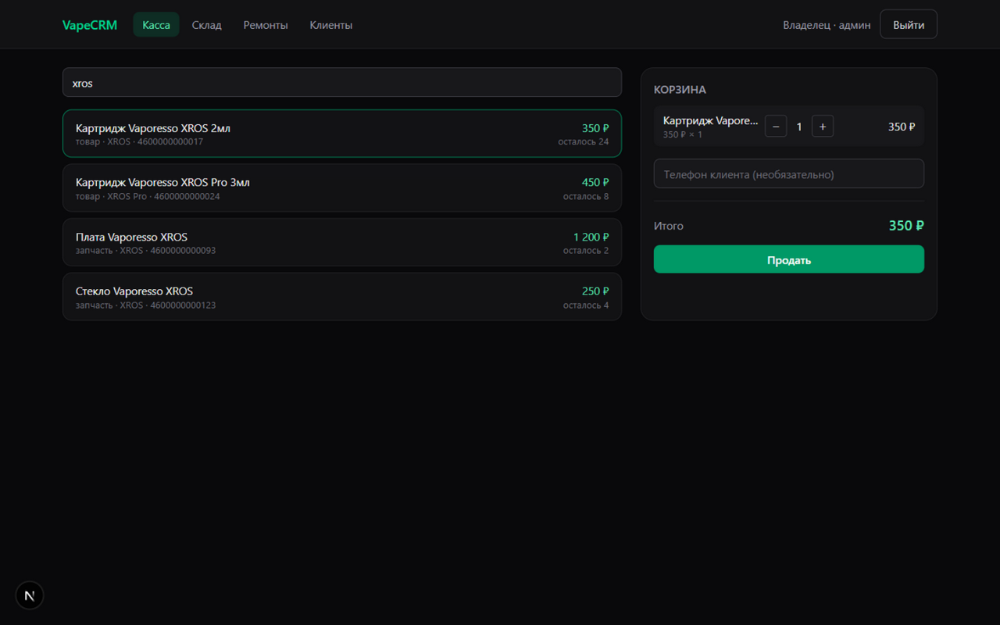
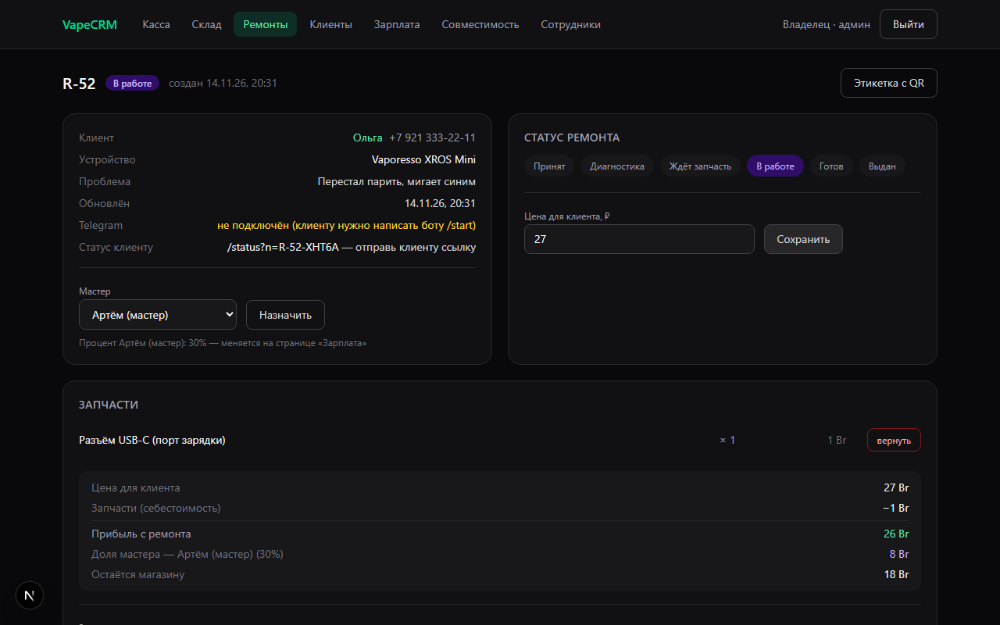
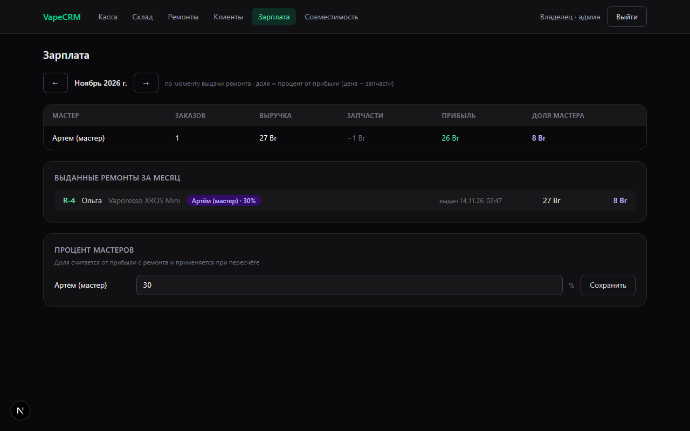
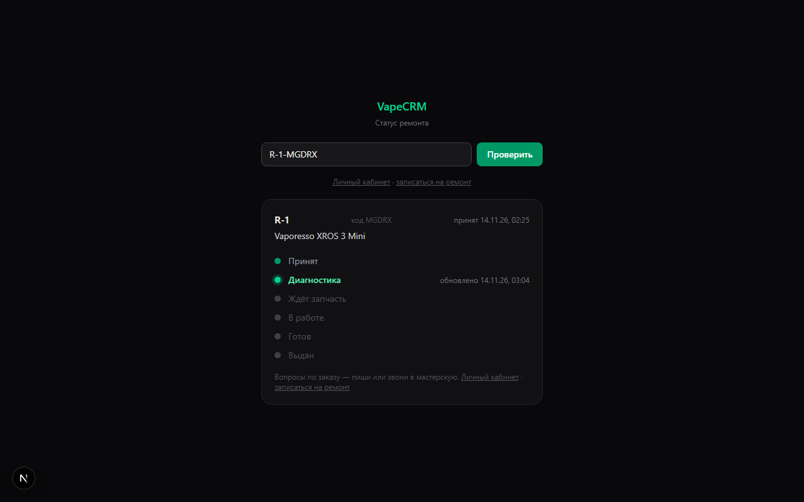

# VapeCRM — мастерская по ремонту вейпов + касса расходников

Система «всё в одном окне» для микробизнеса: приёмка ремонтов со статусами и уведомлениями,
быстрая касса для розницы, умный склад и база клиентов с общей историей ремонтов и покупок.
Все цены — в белорусских рублях (Br), целыми.

**Живое демо:** https://vape-crm-ury1.zai-ai.site (вход `admin/admin123` — владелец, `master/master123` — мастер)

| Касса (POS) | Карточка ремонта |
|---|---|
|  |  |
| **Зарплата мастера** | **Статус для клиента** |
|  |  |

## Возможности

- **Ремонты** — приёмка в два клика (клиент находится по телефону или создаётся), статусы
  «Принят → Диагностика → Ждёт запчасть → В работе → Готов → Выдан», списание запчастей со склада,
  назначение мастера
- **Запись с сайта** — публичная страница `/book`: клиент сам оставляет заявку (имя, телефон,
  устройство, желаемое время) без входа в систему; заявка падает в общий список ремонтов,
  honeypot от спам-ботов
- **Личный кабинет клиента** — `/cabinet/register`: клиент создаёт пароль к своему телефону
  и получает `/my` — все свои ремонты и покупки в одном таймлайне; сессии клиентов отделены
  от сессий сотрудников
- **PWA** — приложение устанавливается на телефон/компьютер (манифест, иконки, service worker)
- **Номера Беларуси и России** — `+375 25/29/33/44 …` (мобильные), `+375 17 …` (Минск),
  `8 029…`, `+7 916 …` — нормализуются к национальному формату и работают одинаково
  в приёмке, кассе, боте и записи с сайта
- **Касса (POS)** — поле для сканера штрихкодов (точное совпадение по Enter) и живой поиск
  по названию/модели («xros» → все картриджи XROS), корзина, списание остатков в транзакции
- **Склад** — товары на продажу и запчасти, порог «мало осталось» с подсветкой,
  поступление товара; себестоимость и цены видит только админ
- **Закупка** — список позиций, доехавших до порога, с рекомендацией «добить до 2× минимума»
  и бюджетом по себестоимости; закрывается обычным поступлением товара
- **Клиенты** — карточка с общим таймлайном ремонтов и покупок
- **Зарплата** — прибыль с ремонта (цена − себестоимость запчастей), процент мастера
  настраивается, отчёт по месяцам с моментом выдачи; мастер видит свою долю, админ — всю маржу
- **Telegram-бот** — привязка клиента через `/start`, уведомление при «Готов» и «Выдан»,
  напоминание о картридже через 14 дней после покупки, «давно не забираете» если ремонт
  висит готовым дольше 3 дней; `/status <номер>` — статус прямо в боте, `/book` — запись
  через диалог, `/help` — подсказки
- **Роли** — ADMIN (всё, включая цены и себестоимость) и MASTER (ремонты + касса)
- **Сотрудники** — админ создаёт сотрудников, меняет пароли и отключает доступ
  (уволенный теряет сессию мгновенно); единый вход: сотрудник — логином, клиент — телефоном
- **Статус для клиента** — публичная страница `/status`: клиент вводит номер с кодом с квитанции
  (`R-3-KX4P`) и видит прогресс ремонта (без личных данных, без входа в систему)
- **QR-этикетка** — на карточке ремонта кнопка «Этикетка с QR»: наклейка 58×40 мм с QR
  на страницу статуса этого заказа
- **Совместимость** — справочник «модель → алиасы линейки» (XROS = «XROS Mini, XROS 3…»);
  алиасы работают в поиске кассы: «xros mini» находит картриджи XROS
- **Напоминания** — после продажи картриджа бот через 14 дней напомнит клиенту «пора сменить»
- Тёмная тема — продавцы работают при приглушённом свете

## Стек

Next.js 16 + TypeScript + Tailwind (тёмная тема) · Prisma + SQLite · grammY для бота ·
bcrypt + cookie-сессии для авторизации

## Запуск

**Кратко:** с телефона и компьютера открывай готовое приложение
https://vape-crm-ury1.zai-ai.site (установка как приложение — см. ниже).
Полная инструкция с частыми проблемами — в файле [QUICKSTART.md](QUICKSTART.md).

Локальный запуск (нужен Node.js 22.6+):

```bash
npm install
npm run db:init   # создать базу SQLite и залить демо-данные
npm run dev       # приложение на http://localhost:3000
```

Демо-аккаунты: `admin/admin123` (владелец) и `master/master123` (мастер).

### Установка как приложение (PWA)

- **Android, Chrome**: меню ⋮ → «Установить приложение» → иконка на рабочем столе
- **iPhone, Safari**: «Поделиться» → «На экран “Домой”»
- **Компьютер, Chrome/Edge**: значок установки ⊕ в адресной строке → «Установить»

### Telegram-бот

1. Создай бота у [@BotFather](https://t.me/BotFather), получи токен
2. Вставь токен в `.env` (`TELEGRAM_BOT_TOKEN="..."`)
3. Запусти в отдельном терминале: `npm run bot`
4. Клиент пишет боту `/start` и свой номер телефона — бот привязывает чат к карточке клиента
5. При смене статуса ремонта на «Готов»/«Выдан» клиент получает сообщение

## Скрипты

| Команда | Что делает |
|---|---|
| `npm run dev` | приложение в режиме разработки |
| `npm run db:init` | создать/обновить базу + демо-данные |
| `npm run db:seed` | залить демо-данные в существующую базу |
| `node scripts/reset-stock.mjs` | вернуть остатки склада к демо-значениям |
| `npm run bot` | Telegram-бот |
| `npm run build` | прод-сборка |

## Структура

```
app/(app)/        страницы после логина (касса, склад, ремонты, клиенты, зарплата, совместимость)
app/status/       публичная страница статуса заказа для клиента
app/book/         публичная запись на ремонт с сайта
app/cabinet/      вход/регистрация клиента в личный кабинет
app/my/           личный кабинет клиента (свои ремонты и покупки)
public/icons/     PWA-иконки (node scripts/gen-icons.mjs)
app/login/        страница входа
app/actions/      серверные экшены (auth, inventory, sales, repairs, clients, compatibility, users)
app/api/products/ поиск товаров для кассы (с алиасами совместимости)
bot/index.ts      Telegram-бот (grammY)
lib/              db, auth, статусы, зарплата, напоминания, коды
prisma/           schema.prisma + seed с демо-данными
scripts/          смоук-тесты (node scripts/smoke-test.mjs и др.)
db/data.db        база SQLite (в .gitignore)
```

## Дорожная карта

- Отчёты и графики (план/факт, активность мастеров)
- Поставщики и автозаказ у поставщика
